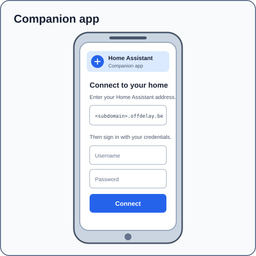
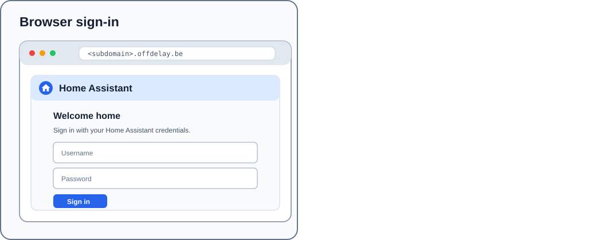
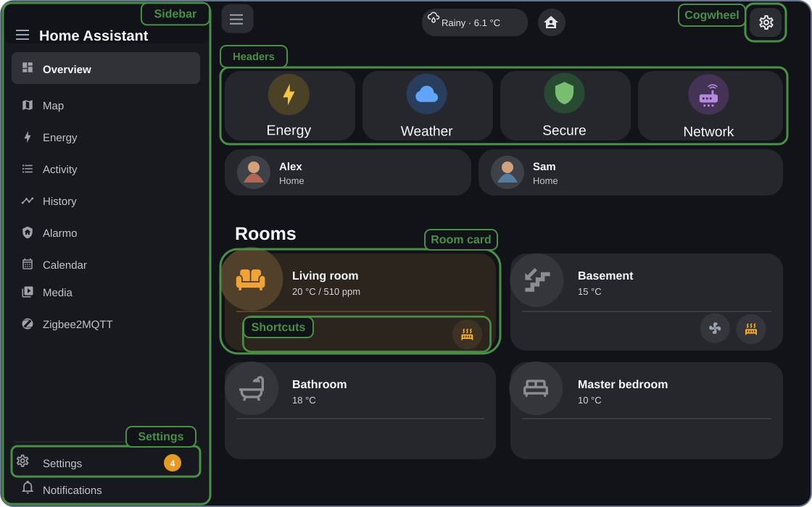
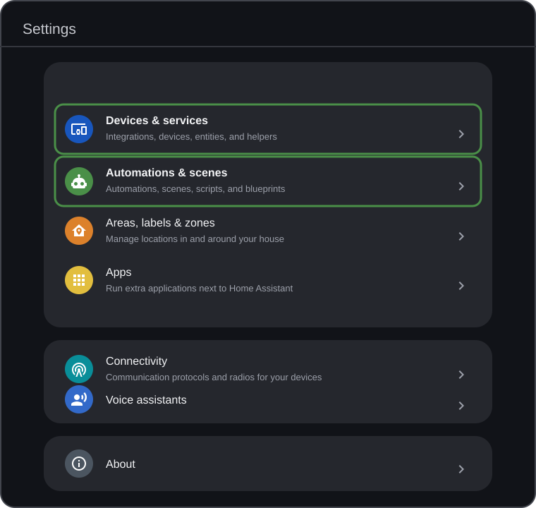
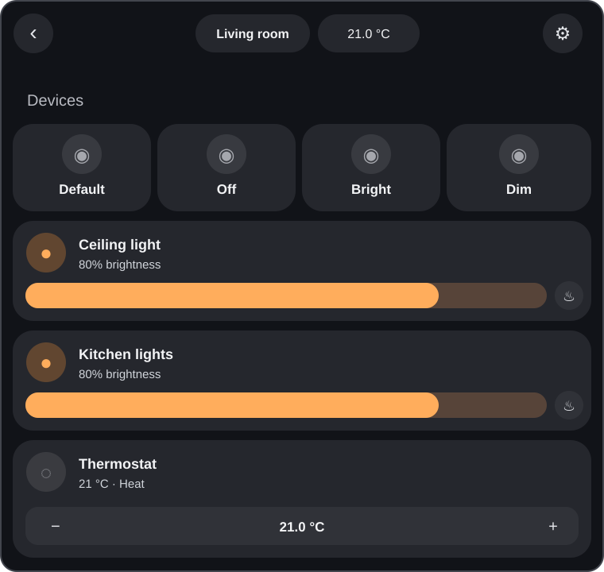
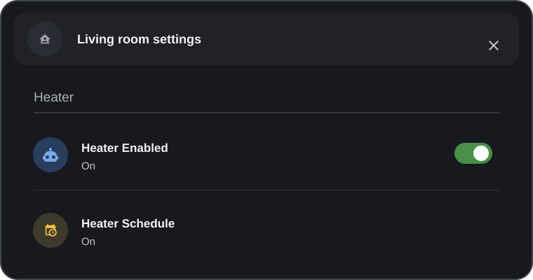

# Basics

Use either a browser or the Home Assistant Companion app to connect to your Home Assistant instance. Once signed in, use the sidebar to open dashboards, maps, energy information, integrations such as Zigbee2MQTT, and settings.

## Connect to Home Assistant

Connect locally at `homeassistant.local` or remotely at `<subdomain>.offdelay.be` (use your assigned subdomain). Sign in with your Home Assistant credentials, then choose Browser or App:

=== "App"

    Install the Home Assistant Companion app on your iOS or Android device. Add your local or external address in the app, then sign in with your Home Assistant credentials. This wireframe shows the address and sign-in steps in the app.

    

=== "Browser"

    Open a browser on your computer and enter either the local or external address above. This example shows a browser window on macOS and Windows; the same address works in other supported browsers.

    

## Navigate Home Assistant

Home Assistant's Overview brings together navigation, dashboard headers, room cards, and shortcuts.

=== "Settings"

    **Devices & services** shows your integrations, devices, entities, and helpers. Open an integration to inspect its entities. If an integration needs attention, use its available controls to reauthenticate or reload it.

    **Automations & scenes** is where you create and manage automations and scenes. Use it to change what your home does automatically or to configure a scene.

    

=== "Room card"

    Select a room card to open that room's devices and controls. Adjust supported devices here, such as switching lights on or off, changing brightness, or controlling a thermostat. Use the cogwheel in the room header to open settings for that room.

    

=== "Cogwheel"

    The cogwheel opens settings for the selected room. Adjust room-specific options here, such as whether the heater is enabled or follows a schedule. These settings apply to the room; available options depend on the devices and configuration in your Home Assistant instance.

    
