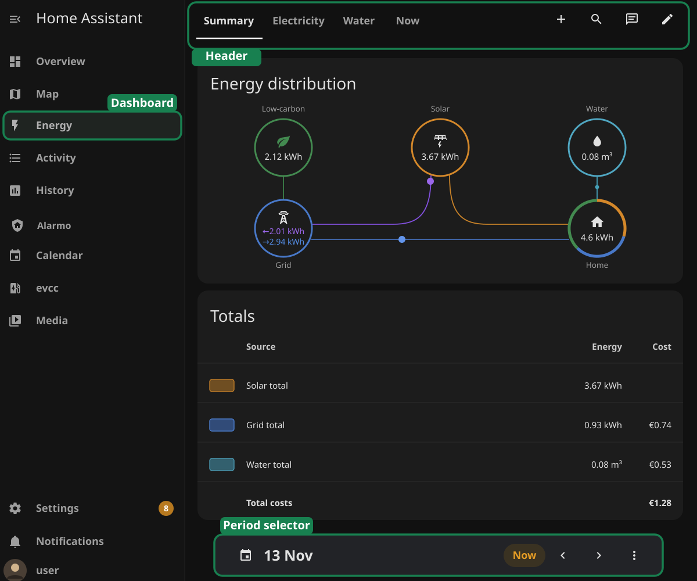
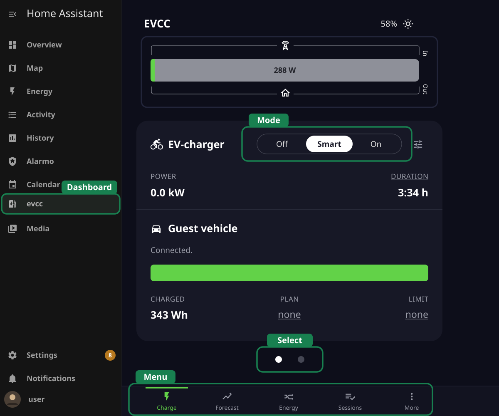

# Energy

The Energy module is built entirely with the EVCC add-on and the EVCC integration.

## Devices

The module supports all device types supported by EVCC:

-   <svg viewBox="0 0 24 24" aria-hidden="true" focusable="false"><path fill="currentColor" d="M13 2 4 14h6l-1 8 11-13h-7z"/></svg> **[Chargers](https://docs.evcc.io/en/chargers)**

    Control charging.

-   <svg viewBox="0 0 24 24" aria-hidden="true" focusable="false"><path fill="currentColor" d="M12 3a9 9 0 0 0-9 9v7h18v-7a9 9 0 0 0-9-9m0 2a7 7 0 0 1 7 7v5H5v-5a7 7 0 0 1 7-7m4.8 2.8-5.3 5.3a2 2 0 1 0 1.4 1.4z"/></svg> **[Meters](https://docs.evcc.io/en/meters/)**

    PV, Battery, Grid, Meters.

-   <svg viewBox="0 0 24 24" aria-hidden="true" focusable="false"><path fill="currentColor" d="m5 11 1.5-4.5A2 2 0 0 1 8.4 5h7.2a2 2 0 0 1 1.9 1.5L19 11l2 2v6h-2v-2H5v2H3v-6zm2.4-4L6.2 11h11.6l-1.2-4zM6 13a1.5 1.5 0 1 0 0 3 1.5 1.5 0 0 0 0-3m12 0a1.5 1.5 0 1 0 0 3 1.5 1.5 0 0 0 0-3"/></svg> **[Vehicles](https://docs.evcc.io/en/vehicles/)**

    To limit charging to a target State of Charge (SoC).

-   <svg viewBox="0 0 24 24" aria-hidden="true" focusable="false"><path fill="currentColor" d="M7 3a4 4 0 1 0 0 8 4 4 0 0 0 0-8m0 2a2 2 0 1 1 0 4 2 2 0 0 1 0-4m10 8a4 4 0 1 0 0 8 4 4 0 0 0 0-8m0 2a2 2 0 1 1 0 4 2 2 0 0 1 0-4M7 13v8h2v-8m8-10v8h2V3z"/></svg> **[Smart switches](https://docs.evcc.io/en/smartswitches/)**

    Solution to control anything.

-   <svg viewBox="0 0 24 24" aria-hidden="true" focusable="false"><path fill="currentColor" d="M5 3h2v18H5zm4 0h2v18H9zm4 0h2v18h-2zm4 0h2v18h-2zM3 7h18v2H3zm0 8h18v2H3z"/></svg> **[Heating](https://docs.evcc.io/en/heating/)**

    Boost boilers or use the SG-ready function.

-   <svg viewBox="0 0 24 24" aria-hidden="true" focusable="false"><path fill="currentColor" d="M5 3h14a2 2 0 0 1 2 2v14a2 2 0 0 1-2 2H5a2 2 0 0 1-2-2V5a2 2 0 0 1 2-2m0 2v14h14V5zm6 2h2v4h4v2h-4v4h-2v-4H7v-2h4z"/></svg> **[User-defined devices](https://docs.evcc.io/en/user-defined-devices/)**

    DIY solution to everyting.

## Integration/apps

Install the EVCC add-on and connect it to Home Assistant with the EVCC integration.

## Automation

Use the EVCC entities in Home Assistant automations to respond to energy data and device states.

## Visualisation

View your home's energy in either the Home Assistant Energy dashboard or the EVCC dashboard.
The Home Assistant dashboard also includes water and gas, while the EVCC dashboard gives
more detail about energy control and optimisation in your home.

=== "Home Assistant"

    

=== "EVCC"

    

