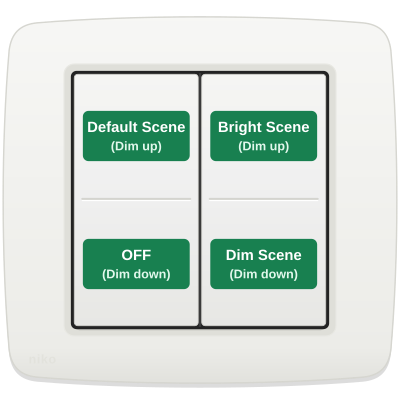
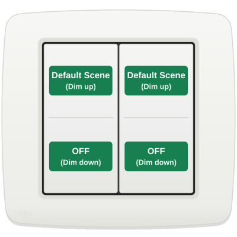
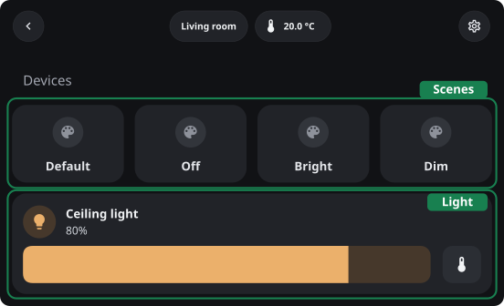

# Lighting

Control your lighting manually or automate it with motion. By fine-tuning both brightness and warmth, your lights add depth to every room—effortlessly creating the ideal mood from morning to night.

!!! warning "Motion-controlled lights"
    The controls below do not apply to motion-controlled lights. To control these lights manually, first disable the associated automation.

## Physical Controls

Physical buttons can use either of these configurations:

=== "Offdelay configuration"

    

=== "Standard configuration"

    

## Dashboard Control

Open a room card on the dashboard to control its lights.

!!! tip
    Double-click a room card to turn off all the lights in that room.

## Configuration

### Add device

=== "Light"

    1. Open **Settings → Devices & services**.
    2. Select the integration that supports the light.
    3. Choose **Add device**.
    4. Put the light in pairing mode and follow the on-screen instructions.
    5. Assign the light to the correct room.

=== "Kinetic switch"

    1. Open **Settings → Devices & services**.
    2. Select the integration that supports the kinetic switch.
    3. Choose **Add device**.
    4. Put the switch in pairing mode and follow the on-screen instructions.
    5. Assign the switch to the correct room and check its button entities.

### Add visualisation

Add light controls to a room dashboard so you can select scenes and control supported lights. See [Visualisation](../../setup/visualisation.md) for dashboard setup.

### Add automation

Create an automation to adjust brightness and warmth in response to motion and the time of day. See [Automations](../../setup/automations.md) for automation setup.
