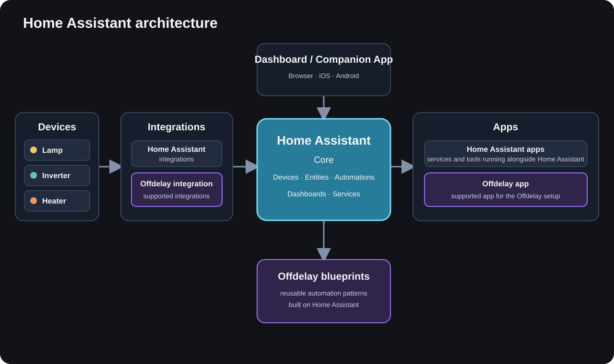

# Setup

Set up a working Home Assistant installation, then add the components and conventions used by Offdelay. Start with the controller and cellphone, add integrations and apps for your devices and services, then continue with naming, visualisation, and automations.

The diagram shows how devices connect through integrations to Home Assistant, with apps and Offdelay blueprints extending the setup.

## Setup topics

- [Installation](installation.md) — choose a controller, install Home Assistant OS, and configure the cellphone.
- [Integrations](integrations.md) — connect Home Assistant to devices, services, and software.
- [Apps](apps.md) — install apps that run alongside Home Assistant.
- [Naming convention](naming-convention.md) — name devices and entities consistently.
- [Visualisation](visualisation.md) — arrange dashboards and controls.
- [Automations](automations.md) — combine triggers, conditions, and actions.
